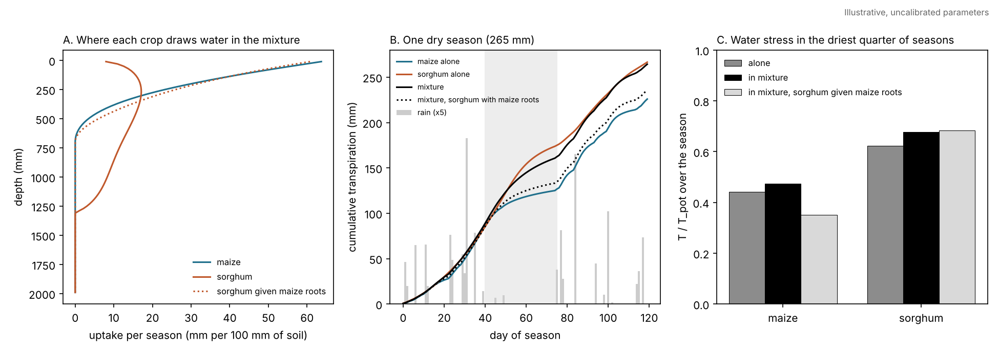
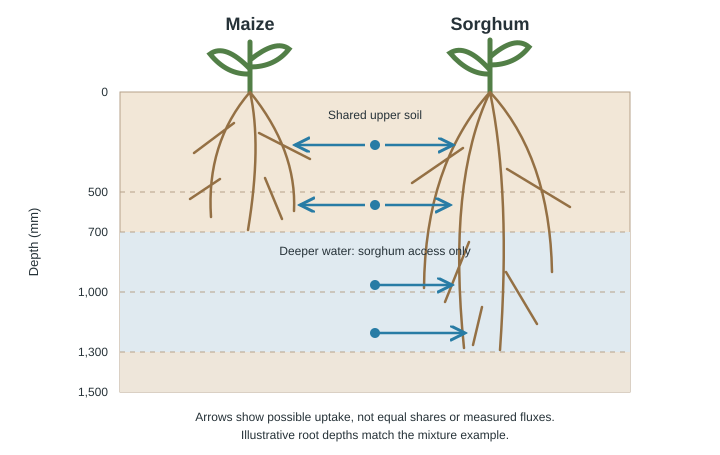

<p align="center"></p>

# SoilWaterFlow

One-dimensional soil water flow and root water uptake for food security questions: which crops, varieties and mixtures keep transpiring through a dry spell, and why.

`soilwaterflow` solves the Richards equation for unsaturated flow in a soil column with root water uptake, evaporation, infiltration, ponding and runoff. It is a Python port of PLANT1D, the Fortran code developed by Michael A. Celia (Princeton University) and extended by Andrew J. Guswa (Smith College) and Michael J. Puma (Columbia University), and used in Puma et al. (2007). The port reproduces the Fortran **bit for bit** and extends it so that **several crop varieties share one soil column, each with its own roots**.

The question it adds over a single-bucket soil model is *where* in the soil water is, and which plant can reach it. A bucket shares one pool of water among all plants; here a deep-rooted sorghum and a shallow-rooted maize draw from different depths, and the water each leaves behind is the water the other can use.



*Example output (`examples/mixture_demo.py`, illustrative and uncalibrated parameters). A: in a 50/50 mixture, maize takes its water from the top 700 mm and sorghum from down to 1,300 mm. B: through a mid-season dry spell, the mixture keeps transpiring nearly as well as sorghum alone; giving sorghum maize's roots removes most of that advantage. C: in the driest quarter of 40 seasons, maize is less water-stressed in the mixture than alone, but more stressed when its neighbour roots at the same depth.*

## Install

```bash
pip install git+https://github.com/mjpuma/SoilWaterFlow
```

or, to develop and run the tests:

```bash
git clone https://github.com/mjpuma/SoilWaterFlow && cd SoilWaterFlow
pip install -e ".[test,examples]"
pytest                      # about 1 minute
```

It needs Python 3.9 or later, numpy and numba. The first run compiles the solver (about 10 s); later runs reuse the compiled code.

## Quick start from the command line

```bash
soilwaterflow run examples/quickstart.json
```

`quickstart.json` names a soil, the crop varieties, a CSV of daily rain and (optionally) a CSV of daily canopy cover for each variety, and writes the daily water balance to `quickstart_daily.csv`: rain, infiltration, runoff, evaporation, drainage, leakage below the roots, storage, and for each variety actual and potential transpiration and root-zone saturation.

```json
{
  "soil": "sandy_loam_example",
  "varieties": [
    {"name": "maize",   "t_max": 4.5, "s_star": 0.48, "s_w": 0.22, "root_depth": 700,  "root_shape": [1.0, 3.0]},
    {"name": "sorghum", "t_max": 3.8, "s_star": 0.40, "s_w": 0.17, "root_depth": 1300, "root_shape": [1.3, 1.7]}
  ],
  "rain": "rain_example.csv",
  "cover": "cover_example.csv",
  "options": {"depth": 2000, "dz": 20, "s0": 0.35, "storm_hours": 4, "dt_max": 0.05, "bottom": "free"}
}
```

`soil` can also be a dictionary of `Soil` parameters, or `{"preset": "sandy_loam_example", "k_sat": 400}` to change one. Varieties can be given with heads (`h_star`, `h_wilt`, mm) instead of relative soil moisture (`s_star`, `s_w`). `cover` can be omitted (equal shares, full cover) or a list of constant shares.

## Use from Python

```python
import numpy as np
from soilwaterflow.model import Soil, Variety, simulate

soil = Soil.sandy_loam_example()           # illustrative; see Soil for the parameters
maize = Variety.from_saturations("maize", t_max=4.5, s_star=0.48, s_w=0.22, soil=soil,
                                 root_depth=700, root_shape=(1.0, 3.0))
sorghum = Variety.from_saturations("sorghum", t_max=3.8, s_star=0.40, s_w=0.17, soil=soil,
                                   root_depth=1300, root_shape=(1.3, 1.7))

rain = ...                                  # (n_days,) mm
cover = np.c_[0.5 * kc, 0.5 * kc]           # (n_days, n_varieties): planting share x canopy cover
r = simulate(soil, [maize, sorghum], rain, cover=cover, depth=2000, dz=20)

r.transpiration          # (n_days, 2) actual, mm/day
r.transpiration_pot      # (n_days, 2) unstressed: cover x t_max
r.stress                 # 1 - T / T_pot
r.evaporation, r.runoff, r.drainage, r.leakage, r.storage, r.s_root
r.uptake_by_depth        # (2, n_blocks) where each variety drew its water
r.water_balance_error()  # mm; ~1e-4 for a season
```

Everything is in mm and days. `simulate_fields` runs many fields in parallel threads. `Variety.from_saturations` takes the relative soil moisture thresholds used in [tessera](https://github.com/mjpuma/tessera) (s\* and s_w) and converts them to heads with the soil's retention curve, so the same variety table can drive either model. Tessera turns daily actual and potential transpiration into yield (Doorenbos and Kassam 1979); `transpiration` and `transpiration_pot` are those two inputs, and tessera's [`richards.py`](https://github.com/mjpuma/tessera/blob/main/richards.py) uses this package as a drop-in replacement for its bucket soil.

## The model

Soil water moves by the mixed form of the Richards equation,

$$\frac{\partial \theta(h)}{\partial t} = \frac{\partial}{\partial z}\left[K(h)\left(\frac{\partial h}{\partial z} - 1\right)\right] - \sum_v U_v(z, t) - E(z, t)$$

with $z$ positive downward, $h$ the pressure head, $\theta = nS$ the water content and $K = K_s k_{rel}(S)$. Retention and conductivity follow Brooks and Corey (1964), with a short linear segment between the air-entry head and saturation so that $dS/dh$ stays finite. The equation is discretized with block-centered finite differences (harmonic-mean $K_s$, upstream-weighted $k_{rel}$) and solved with the modified Picard iteration of Celia et al. (1990), which conserves mass. Time steps adapt to the number of iterations and land exactly on every change in rainfall rate. When rain exceeds the infiltration capacity the surface ponds and the excess runs off.

**Root water uptake** (after Cowan 1965, as implemented by Guswa and Puma). Variety $v$ takes water from block $j$ at

$$U_{v,j} = c_v\, w_{v,j}\, \Delta z_j\, \frac{h_j - h_{p,v}}{c_{s,v} / (K_s\, k_{rel}(S_j)) + c_{r,v}}$$

- $c_v$ is the variety's canopy cover (planting share times seasonal cover); $w_{v,j}$ its root weights, a beta distribution over its root depth with mean 1.
- The denominator is a soil resistance, which grows as the soil dries, plus a root resistance.
- $h_{p,v}$ is the plant water potential. It is $h_{wilt,v}$ when the soil cannot meet demand; otherwise it rises until total uptake equals $c_v T_{max,v}$ (solved by the secant method). Uptake from any block is never negative.
- $c_{s,v}$ and $c_{r,v}$ are set so that uptake exactly meets $T_{max,v}$ when the whole root zone is at $h^*_v$, and a fraction `frac` of the head drop is across the roots in saturated soil.

So uptake shifts towards wetter layers as the soil dries, and each variety has its own $h_p$: varieties interact only through the water they share. With one variety at full cover this is exactly the PLANT1D uptake function.

### Competition for water in crop mixtures

Neither crop has priority, and water in a shared soil block is not divided equally or in fixed proportion to planting area. Each variety's uptake is calculated from the same current soil pressure head and saturation, using its own root distribution, canopy cover, hydraulic resistances, plant water potential and transpiration demand.

<p align="center"></p>

*Conceptual illustration using the example root depths of 700 mm (maize) and 1,300 mm (sorghum). Arrows indicate possible uptake pathways, not measured fluxes or equal water shares.*

The total root-water sink in soil block $j$ is the sum of the individual uptake rates:

$U_j = \sum_{v=1}^{N_v} U_{v,j}.$

In each modified Picard iteration, the solver:

1. Computes uptake for each variety from the **same** current soil moisture profile. For each plant, uptake is first evaluated at its wilting head; if that exceeds its canopy-scaled potential transpiration, the secant method adjusts plant head to meet demand.
2. Sums the individual uptake rates in each soil block. The soil state is not changed between variety calculations.
3. Solves the discretized Richards equation with this combined sink, along with soil evaporation and boundary fluxes.
4. Repeats with the updated soil state until convergence, adapting the time step as needed.

See [the uptake function](src/soilwaterflow/_kernel.py#L62-L113) and [the combined sink calculation](src/soilwaterflow/_kernel.py#L336-L367). The order in which varieties are listed therefore does not confer physical priority.

A 50/50 planting mixture does not necessarily have 50/50 water uptake. Greater local root density, lower hydraulic resistance, and a larger soil-to-plant head difference can increase extraction from a shared block, all else equal; deeper roots can access additional water, and a more negative wilting head can permit continued uptake under drier conditions. Actual uptake also depends on the demand constraint and the evolving soil moisture profile. As either variety extracts water, the resulting decline in soil head and conductivity feeds back on both varieties.

This is a one-dimensional, horizontally averaged representation of belowground competition. It does not resolve localized depletion around individual roots or lateral separation between crop rows. Uptake is clipped at zero, so root-mediated hydraulic redistribution is excluded. A useful numerical diagnostic is to reverse the order of the varieties and the associated canopy-cover columns, then compare soil profiles and crop-specific transpiration after restoring the original output order (allowing for numerical tolerance).

**Soil evaporation** is at its potential rate when the soil is wetter than `h_evap`, falling linearly to zero at residual saturation, distributed over the top `z_evap` mm. By default it is scaled by the bare-soil fraction, $1 - \sum_v c_v$.

**Bottom boundary**: free drainage (unit gradient, the default), a fixed head (a water table) or a fixed flux.

## Validation against the Fortran

`legacy/fortran` holds the original 2005 Fortran and the input files for its example (a sandy clay under *Burkea africana*, 400 days of storms). `soilwaterflow.legacy` reads the same input files and writes the same output files:

```bash
soilwaterflow legacy legacy/fortran out/
```

The Fortran as it stood before the port is tagged [`fortran-2018`](https://github.com/mjpuma/SoilWaterFlow/tree/fortran-2018).

All eight output files (`plant1d.pl1`–`pl4`, `.anm`, `.out`, `.ic`, `fort.2`) are **byte-for-byte identical** to the Fortran's, over 202,687 time steps. With the Fortran's output formats widened to 17 significant digits, the final pressure head in all 200 blocks and the cumulative water balance at all 3,999 print times are identical in every bit. `tests/test_legacy.py` checks this on every run. The reference outputs in `tests/data` come from compiling the Fortran with gfortran; they also match the outputs committed to the original repository in 2018.

To build and run the Fortran yourself:

```bash
cd legacy/fortran
gfortran -ffixed-line-length-none -std=legacy -w *.FOR -o plant1d
mkdir run && cd run && for f in ../*.IN; do cp $f $(basename $f | tr A-Z a-z); done && ../plant1d > /dev/null
```

### Behaviour of the Fortran that the port keeps in legacy mode

These are reproduced so the outputs match; the field-scale interface (`soilwaterflow.model`) does not have them.

1. **Convergence test.** `CNVCHK.FOR` assigns the absolute head increment to an integer before comparing it with the tolerance, so any Picard iterate whose increments are all below 1 cm counts as converged, whatever `errpr` is. The residual test is never active (`rmax` is reset to zero and never computed). The field-scale interface uses $|\Delta h| \le$ `tol` $+$ `rtol` $|h|$ in every block.
2. **Root uptake uses the top material's $K_s$** (`rksat(1)`) in every block. This matters only for layered soils.
3. **Runoff bookkeeping when ponded** uses the rainfall rate of the *next* boundary-condition interval on the step that ends exactly at a change in rate. The field-scale interface uses the rate actually applied and closes the water balance to about $10^{-5}$ mm.
4. **Reading past the end of the boundary-condition arrays.** After the last boundary-condition time, `PLANT1D.FOR` reads `timet(ntopbc+1)`, which is zero, and would send the clock back to $t = 0$. The example run escapes only because rounding leaves the last print time slightly above `tmax`. The port pads the arrays with a time that is never reached.

The stress-statistics routine (`STRESSONE.FOR`) and its output files are not ported; its files were empty for the example. Compute stress from `r.stress` instead.

## Accuracy and speed

For one year of daily rain on a 1.5 m column (sandy loam, maize at full cover), annual transpiration changes by less than 0.1 mm when the largest time step goes from 0.002 to 0.05 day, and by about 1 mm (0.2%) when blocks go from 10 to 25 mm. The water balance closes to about $10^{-4}$ mm per year. A field-year takes about 1 s at `dt_max=0.05, dz=25` and 4 s at `dt_max=0.02, dz=10` on one core; `simulate_fields` uses all cores. The legacy example (200 blocks, `dtmax` 0.002 day, 400 days) takes about 45 s.

This is fast enough for calibrated sites, ensembles of seasons and benchmarks of a bucket model. It is far slower than a bucket, so for very large ensembles of field-years a bucket model calibrated against this one is still the practical choice.

## Repository layout

```
src/soilwaterflow/
  soil.py          Brooks-Corey functions (ports of FNCSAT, FNCPR, FNCDSDP, FNCKREL, FNCPOR, FNCEVAP)
  _kernel.py       time stepping for one column (PLANT1D and its subroutines), compiled with numba
  model.py         field-scale interface: Soil, Variety, simulate, simulate_fields
  legacy.py        reads and writes the original PLANT1D files
  cli.py           command line: soilwaterflow run / soilwaterflow legacy
  fortran_io.py    Fortran list-directed input and E/F output formats
legacy/fortran/    original Fortran source and example inputs (2005)
legacy/matlab/     original pre- and post-processing scripts
tests/             bit-for-bit comparison with the Fortran; checks of the multi-variety model
examples/          quickstart configuration and data; maize-sorghum mixture example
assets/            logo (SVG sources and PNG)
```

## References

Brooks, R. H., and Corey, A. T. (1964). *Hydraulic Properties of Porous Media*. Hydrology Paper 3. Fort Collins: Colorado State University.

Celia, M. A., Bouloutas, E. T., and Zarba, R. L. (1990). A general mass-conservative numerical solution for the unsaturated flow equation. *Water Resources Research*, 26(7), 1483–1496.

Cowan, I. R. (1965). Transport of water in the soil-plant-atmosphere system. *Journal of Applied Ecology*, 2(1), 221–239.

Doorenbos, J., and Kassam, A. H. (1979). *Yield Response to Water*. FAO Irrigation and Drainage Paper 33. Rome: FAO.

Guswa, A. J., Celia, M. A., and Rodriguez-Iturbe, I. (2002). Models of soil moisture dynamics in ecohydrology: a comparative study. *Water Resources Research*, 38(9), 1166.

Laio, F., Porporato, A., Ridolfi, L., and Rodriguez-Iturbe, I. (2001). Plants in water-controlled ecosystems: active role in hydrologic processes and response to water stress. II. Probabilistic soil moisture dynamics. *Advances in Water Resources*, 24(7), 707–723.

Puma, M. J., Rodriguez-Iturbe, I., Celia, M. A., and Guswa, A. J. (2007). Implications of rainfall temporal resolution for soil-moisture and transpiration modeling. *Transport in Porous Media*, 68, 37–67.

## Credits and license

Fortran (PLANT1D, 2000–2005): Michael A. Celia, Andrew J. Guswa and Michael J. Puma. Python port and multi-variety extension (2026): Michael J. Puma. MIT License.

Michael J. Puma, Center for Climate Systems Research, Columbia University.
